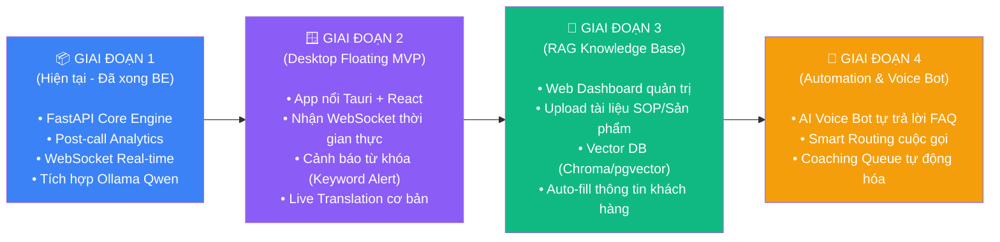

# VoiceIQ — AI Call Intelligence & Universal Agent Assist Platform

> **VoiceIQ** là nền tảng AI thông minh toàn diện phục vụ cho **Call Center & Chăm sóc khách hàng thế hệ mới**, kết hợp phân tích cuộc gọi chuyên sâu (Call Analytics), hỗ trợ tổng đài viên theo thời gian thực (Real-time Agent Assist) và thanh công cụ trợ lý nổi trên màn hình (Desktop Floating Overlay).

---

## 🎯 1. Tầm Nhìn Sản Phẩm (Product Vision)

Sản phẩm không chỉ dừng lại ở một công cụ "chấm điểm cuộc gọi sau khi kết thúc", mà định hướng trở thành **Một lớp trợ lý AI trực quan (Universal AI Context Layer)**:

1. **Dành cho Tư vấn viên (Agent / User)**:
   - Một **thanh công cụ nhỏ nổi trên màn hình (Desktop Floating Window)** có thể kéo thả, ghim lên trên mọi phần mềm (CRM, Softphone, Video/Clip).
   - Tự động bắt từ khóa nhạy cảm, đo lường cảm xúc thời gian thực (Sentiment Meter), gợi ý câu trả lời và kịch bản tư vấn phù hợp (Next Best Action).
   - Khả năng **dịch thuật trực tiếp (Live Translation)** đa ngôn ngữ cho cả cuộc gọi lẫn video/hội thoại đang phát trên máy tính.

2. **Dành cho Quản lý & Doanh nghiệp (Manager / B2B Admin)**:
   - **Web Dashboard** trực quan hóa toàn bộ chất lượng cuộc gọi, xu hướng phàn nàn của khách hàng, biểu đồ hiệu suất nhân viên.
   - **RAG Knowledge Base (Bộ não tri thức riêng)**: Cho phép upload tài liệu quy trình (SOP), bảng giá, danh mục khóa học/sản phẩm để AI tự học và tư vấn chuẩn xác cho từng doanh nghiệp khác nhau (Multi-tenant).

---

## 🏗️ 2. Kiến Trúc Công Nghệ & Lý Do Lựa Chọn (Tech Stack Rationale)

Hệ thống được tách bạch hoàn toàn giữa **Backend (Bộ não AI)** và **Frontend (Giao diện người dùng)**:

### 🧠 Backend (BE): Python + FastAPI
* **Ngôn ngữ**: Python 3.13+ (Hệ sinh thái số 1 thế giới về AI, LLM, RAG và xử lý ngôn ngữ tự nhiên).
* **Framework**: **FastAPI** (Thay vì Flask hay Django):
  - **Native Async (`async/await`)**: Xử lý bất đồng bộ cực nhanh. Khi LLM (Ollama) mất vài giây suy luận, server không bị "đứng hình" (non-blocking), vẫn đồng thời phục vụ hàng trăm cuộc gọi khác.
  - **Tích hợp sẵn WebSocket**: Truyền nhận âm thanh và tín hiệu coaching 2 chiều với độ trễ siêu thấp (< 100ms) mà không cần cài đặt thêm plugin phức tạp.
  - **Kiểm tra dữ liệu tự động với Pydantic**: Đảm bảo chuẩn hóa request/response, bắt lỗi dữ liệu ngay từ cổng vào, trả lỗi chuẩn RFC 7807 Problem Details.
  - **Tự động sinh tài liệu Swagger (`/docs`)**: Hỗ trợ test và debug API trực tiếp trên trình duyệt tiện lợi.
* **Database**: PostgreSQL (SQLAlchemy Async + asyncpg + Alembic migration) thiết kế chuẩn Multi-tenant (RLS).
* **AI Core**:
  - Chạy mô hình mã nguồn mở cục bộ qua **Ollama** (khuyến nghị `qwen2.5:14b` hoặc `qwen2.5:7b` tối ưu cho tiếng Việt, chi phí vận hành $0$).
  - Thiết kế theo mô hình **Ports & Adapters**, dễ dàng chuyển đổi sang OpenAI (GPT-4o) hoặc Google Gemini khi cần.

### 🖥️ Frontend (FE): ReactJS Ecosystem
* **Ngôn ngữ**: JavaScript / TypeScript.
* **Tại sao chọn ReactJS?**: "Học một lần, làm được cả Web lẫn App máy tính". Cùng một tư duy component và kỹ năng React:
  1. **Desktop Floating Overlay App (Cho Tư vấn viên)**: Sử dụng **Tauri + ReactJS**.
     - *Ưu thế*: Nhẹ hơn Electron rất nhiều (chỉ tốn ~30-50MB RAM so với 400MB của Electron), mở tức thì, hỗ trợ làm cửa sổ trong suốt (`transparent`), luôn nổi trên cùng (`always-on-top`), kéo thả tự do.
  2. **Web Dashboard Portal (Cho Quản lý & Admin)**: Sử dụng **Next.js (React) + TailwindCSS + shadcn/ui**.
     - *Ưu thế*: Dựng giao diện bảng biểu, biểu đồ phân tích và khu vực upload file RAG cực kỳ nhanh và chuyên nghiệp.

---

## 🗺️ 3. Lộ Trình Phát Triển Chi Tiết (Roadmap)



### Chi tiết các giai đoạn:

* **Giai đoạn 1: Nền tảng Backend Cốt lõi (Hiện tại)**
  - Đã chuẩn hóa toàn bộ code backend theo kiến trúc CQRS + Ports & Adapters.
  - Phân tích hậu kỳ (Post-call): Tự động xuất Sentiment, Emotion, Phân loại Topic/Intent, Trích xuất thực thể (NER), Tóm tắt cuộc gọi (Issue / Resolution / Next steps).
  - Kết nối WebSocket phục vụ trợ lý thời gian thực.

* **Giai đoạn 2: Desktop Floating Overlay Client**
  - Xây dựng ứng dụng cửa sổ nhỏ nổi trên màn hình bằng Tauri + ReactJS.
  - Hiển thị transcript từng câu khi đang gọi.
  - Bắt từ khóa nhạy cảm (ví dụ: *"hủy hợp đồng"*, *"khiếu nại"*, *"chậm trễ"*) $\rightarrow$ Tự động bật thẻ gợi ý kịch bản xử lý ngay lập tức.
  - Bổ sung tính năng dịch trực tiếp nội dung âm thanh/video trên màn hình.

* **Giai đoạn 3: RAG Knowledge Base & Web Portal**
  - Xây dựng Web Dashboard cho quản lý xem báo cáo QA chấm điểm.
  - Tích hợp RAG: Doanh nghiệp upload tài liệu nội bộ $\rightarrow$ AI tự chia nhỏ (chunking), tạo embedding $\rightarrow$ Tư vấn viên hỏi câu gì, AI tra cứu đúng tài liệu đó để gợi ý.
  - Cơ chế Multi-tenant: Mỗi doanh nghiệp khách hàng có một kho tri thức riêng biệt.

* **Giai đoạn 4: Voice Bot & Tự Động Hóa Nâng Cao**
  - Mở rộng sang kênh AI Voice Bot tự động tiếp nhận các cuộc gọi lặp đi lặp lại (hỏi giờ mở cửa, tra cứu trạng thái đơn hàng...).
  - Tự động tạo task và cập nhật dữ liệu sau cuộc gọi vào hệ thống CRM.

---

## ⚡ 4. Hướng Dẫn Cài Đặt & Chạy Nhanh Backend (Quick Start)

### 1. Cấu hình biến môi trường
```bash
cp .env.example .env
```

### 2. Cài đặt thư viện phụ thuộc
Dự án sử dụng trình quản lý gói siêu tốc `uv`:
```bash
uv sync
```

### 3. Chuẩn bị mô hình LLM Cục bộ (Ollama)
Cài đặt [Ollama](https://ollama.com) và tải model khuyến nghị:
```bash
ollama run qwen2.5:14b
# Hoặc phiên bản nhẹ hơn cho máy cấu hình vừa phải:
# ollama run qwen2.5:7b
```

### 4. Khởi chạy Database
```bash
# Bật Docker Postgres
docker compose -f docker-compose.dev.yml up -d

# Áp dụng migration
uv run alembic upgrade head
```

### 5. Khởi chạy FastAPI Server
```bash
uv run uvicorn apps.api_main:app --reload --host 0.0.0.0 --port 8000
```
Truy cập tài liệu API tự động tại: `http://localhost:8000/docs`

---

## 🔌 5. Danh Sách API Chính

| Phương thức | Đường dẫn (Endpoint) | Mục đích sử dụng |
|---|---|---|
| `POST` | `/api/v1/calls/end` | Gửi transcript hoàn chỉnh để AI phân tích toàn diện (Post-call analysis) |
| `GET` | `/api/v1/calls/{call_id}` | Lấy chi tiết kết quả phân tích NLP của cuộc gọi |
| `WS` | `/ws/v1/live/{call_id}` | Kết nối WebSocket hỗ trợ tư vấn viên trực tiếp (Real-time Agent Assist) |
| `GET` | `/health/live` | Kiểm tra trạng thái hoạt động (Liveness probe) |
| `GET` | `/health/ready` | Kiểm tra độ sẵn sàng của dịch vụ (Readiness probe) |

---

## 🧪 6. Kiểm Tra Chất Lượng Code (Quality Assurance)

Luôn chạy bộ kiểm tra trước khi tạo commit mới:
```bash
# Kiểm tra định dạng code
uv run ruff check .

# Kiểm tra kiểu dữ liệu tĩnh nghiêm ngặt
uv run pyright

# Chạy toàn bộ Unit Tests
uv run pytest
```

---

## 📄 Bản Quyền & Định Danh
Dự án được xây dựng và sở hữu độc lập bởi tác giả, phục vụ mục tiêu phát triển giải pháp SaaS AI Call Intelligence chuyên nghiệp.
